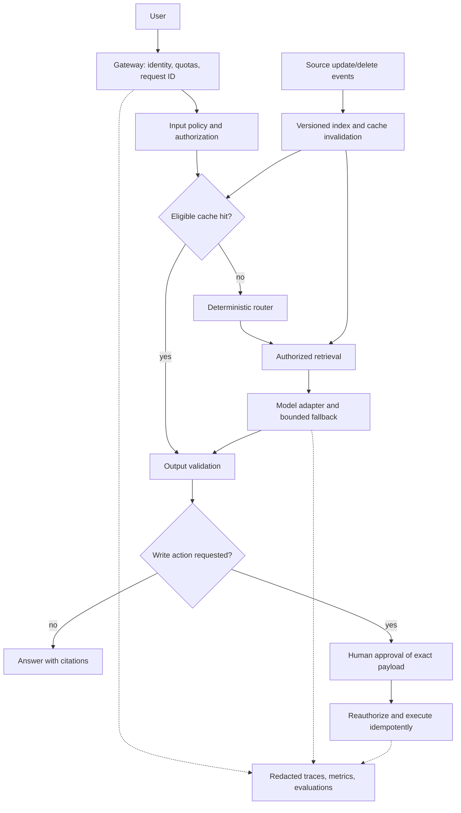

# Architecture reference

This is our proposed reference design, not a reconstruction of the video's exact diagram.

## Contracts to agree before coding

| Component | Required contract | Failure behavior |
|---|---|---|
| Gateway | Verified identity, tenant, request ID, size/rate limits | Reject unauthorized or oversized requests |
| Retrieval | ACL filter, document ID/version, source URL, timestamp | Abstain if authorized evidence is insufficient |
| Cache | Tenant + permission fingerprint + prompt/model + corpus versions | Miss on any mismatch or invalidation |
| Model adapter | Typed input/output, deadline, approved provider list | Bounded retry for transient errors only |
| Router | Explicit route conditions and maximum spend | Reject or degrade within the agreed budget |
| Write executor | Tool allowlist, schema, authorization, idempotency key | Never execute unapproved or altered payloads |
| Trace | Request ID, route, durations, versions, usage, error class | Redact raw sensitive text and credentials |

Authenticate the user before lookup; apply document ACLs during retrieval; recheck output and action permissions. A cache hit must pass the same applicable output policy as a new answer. Semantic similarity must never override identity or freshness boundaries.

## Data freshness

Record source versions and index checkpoints. Treat update/delete events as idempotent; reject older versions. Acknowledge ingestion only after durable indexing. Update the visible corpus generation and invalidate affected cache entries. On permission changes, invalidate authorization-dependent results too. Define an acceptable freshness lag and measure actual source-to-index lag.

## Fallback and retries

Use one overall deadline and bounded attempts. Retry timeouts, rate limits, or selected server errors with jitter; do not retry validation failures or authorization denial. Fallback providers must meet the same data residency and handling requirements. Streaming failures require an explicit partial-response policy. Never replay side-effecting tools blindly after a provider timeout; inspect the execution record using the idempotency key.

## Human approval

Persist pending action ID, normalized payload hash, requester, authorized approver, expiry, and status. At execution, verify approval matches the unchanged payload, reauthorize, and atomically transition state before the write. Keep durable execution receipts. Revocation and expiry must prevent execution. The lab only returns a pending status; it does not implement this approval service.

## Production stack choices

Keep your existing language and hosting platform. A typical starting stack is one API service, the company identity provider, PostgreSQL with vector support when retrieval needs it, a provider adapter, and your existing tracing system. Add a queue for ingestion when event volume warrants it. Add Redis only when measurements justify distributed caching. These are options, not video-endorsed dependencies.
