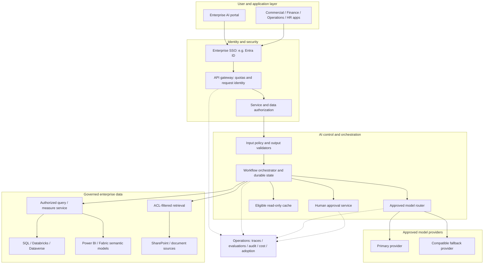
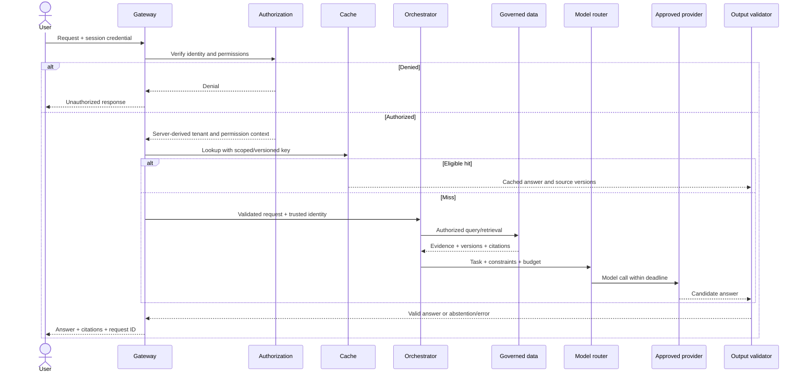
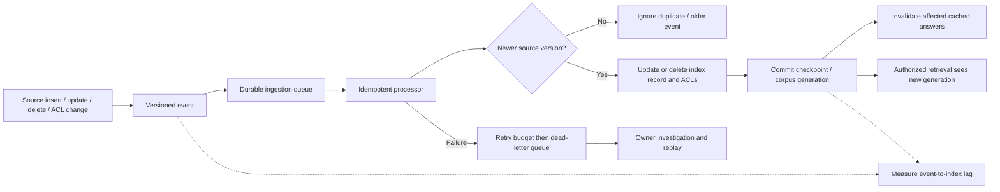
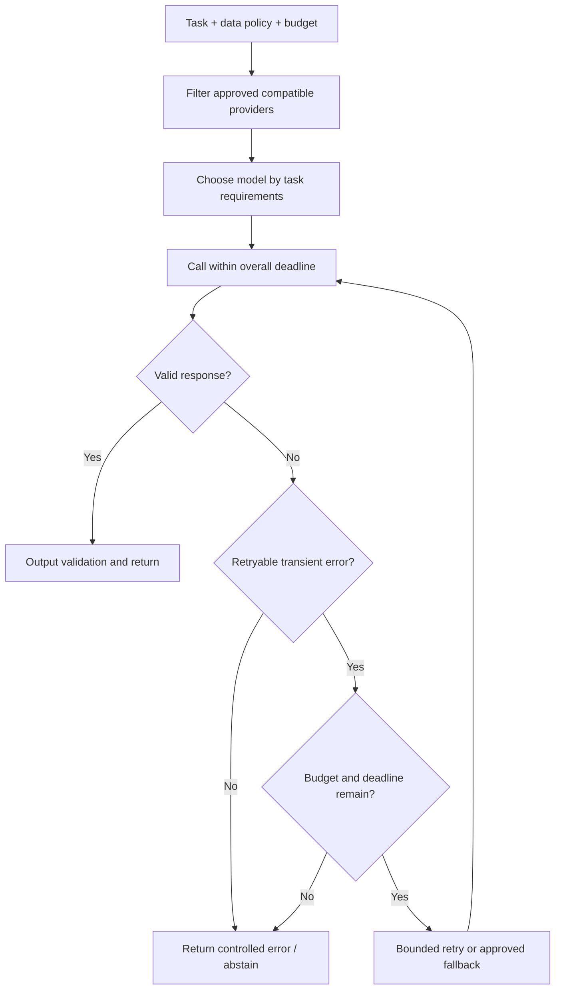
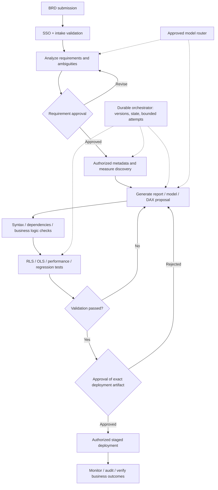

# Architecture diagrams

These are proposed team designs informed by the user-provided learning notes and verified video topics. Mermaid diagrams render directly in GitHub. Each diagram states implementation status; only the limited offline lab is implemented here.

## 1. Enterprise AI CoE — high-level design

**Status:** Reference architecture. Shared controls support multiple business functions; data permissions remain enforced within each service.

Numbers and business KPIs should come from governed queries or semantic measures. Documents support explanation and evidence. Do not assume vector retrieval reliably computes a sales total.

## 2. Request lifecycle — low-level sequence

**Status:** Proposed service interactions. The lab simulates selected boundaries without these services.

Trace every step with a request ID. Validate cache eligibility before returning a hit. No raw credentials or sensitive document text belong in general telemetry.

## 3. Freshness and invalidation

**Status:** Proposed ingestion pipeline; CDC is not implemented in the lab.

Use a coordinated visibility/invalidation strategy so a newly indexed generation cannot serve an old cache entry. Track permission revocations and tombstones, not only inserts.

## 4. Router and bounded fallback

**Status:** One deterministic task route and simulated timeout fallback exist in the lab. Deadlines, retry policies, and circuit breakers below are production design additions.

An authorization denial cannot be bypassed through fallback. Keep write execution separate from inference retries.

## 5. Approval and execution states

**Status:** Proposed durable state machine. The lab stops at pending approval and executes no writes.

```mermaid
stateDiagram-v2
    [*] --> Pending: Store exact payload and expiry
    Pending --> Rejected: Authorized reviewer rejects
    Pending --> Expired: Approval window expires
    Pending --> Approved: Authorized reviewer approves payload hash
    Approved --> Revoked: Approval withdrawn
    Approved --> Expired: Execution window expires
    Approved --> Executing: Recheck hash, ACLs, expiry; atomic claim
    Approved --> Rejected: Payload or permission check fails
    Executing --> Completed: Durable execution receipt
    Executing --> Reconciling: Timeout or uncertain external result
    Reconciling --> Completed: Receipt confirms success
    Reconciling --> Failed: Confirmed failure
    Executing --> Failed: Confirmed failure
    Failed --> Pending: Corrected proposal gets new approval
    Completed --> [*]
    Rejected --> [*]
    Expired --> [*]
    Revoked --> [*]
```

Use the same idempotency key when reconciling an uncertain execution. A changed payload requires a new approval. Prevent simultaneous workers from executing the same action.

## 6. Agentic BI workflow

**Status:** Proposed workflow, not a deployed Power BI integration. Labels represent responsibilities; each can be a deterministic task, human task, or model-assisted agent.

Bound correction loops and escalate after the retry budget. Freeze approved requirements and deployment artifacts by version/hash. Actual deployment requires configured APIs, licenses, credentials, environment permissions, and the project owner's release rules.
